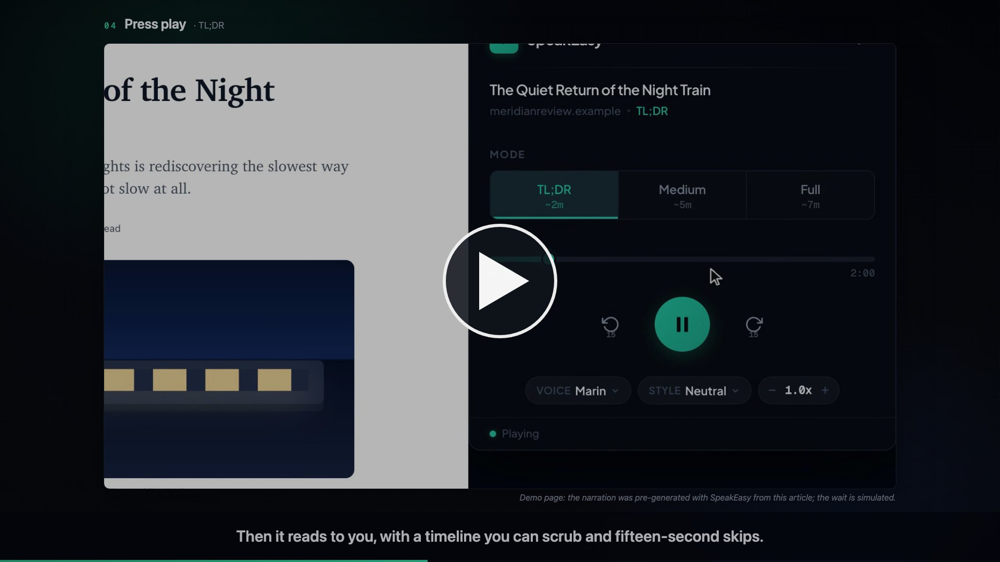

# SpeakEasy

[](https://ericediger.github.io/SPEAKEASY/media/speakeasy-explainer.mp4)

**[⬇ Download and install](#install-speakeasy-no-coding-needed)** · **[▶ Watch the 2-minute explainer](https://ericediger.github.io/SPEAKEASY/media/speakeasy-explainer.mp4)** · **[Try the live demo](https://ericediger.github.io/SPEAKEASY/demo/)**

The demo is the real side panel on a fictional article, with narration pre-generated by SpeakEasy. Nothing is saved, nothing is sent, and no API key is needed.

AI-powered Chrome extension that summarizes web articles and reads them aloud using OpenAI. Free to use with your own OpenAI API key.

## Features

- **Article Extraction** - Automatically extracts article content from any webpage
- **Three Listening Modes** - TL;DR (~2 min), Medium (~5 min), or the Full article
- **10 Voices** - Marin and Cedar (recommended), plus Alloy, Ash, Ballad, Coral, Echo, Sage, Shimmer, Verse
- **Bonus Voice** - The creator's own voice, narrated by ElevenLabs (needs your own ElevenLabs API key)
- **6 Speaking Styles** - Neutral, Energetic, Calm, Professional, Conversational, Storytelling
- **Real-time Controls** - Change voice or style mid-playback, audio regenerates automatically
- **Speed Control** - Adjustable from 0.5x to 2.0x in 0.1 increments
- **Accuracy Check** - Each narrated segment is compared with its text and re-narrated if it drifts
- **Smart Caching** - Summaries and audio cached locally for 7 days to avoid redundant API calls

## How it works

| Step | Model | Notes |
|------|-------|-------|
| Summarize (TL;DR, Medium) | `gpt-6-luna` | ~300 words for TL;DR, ~750 for Medium. Articles already that short are read in full. |
| Read aloud (all modes) | `gpt-realtime-2.1-mini` | Text is narrated in ~1 minute segments, several at a time, then joined into one audio file. |
| Read aloud, bonus voice | ElevenLabs `eleven_multilingual_v2` | Same segments, two at a time, using the creator's voice. Speaking styles adjust the voice's stability and style settings. |

Everything runs in the extension with the user's own key; there is no SpeakEasy server.

### Approximate cost per listen (paid by the user's OpenAI account)

| Mode | Cost |
|------|------|
| TL;DR | ~5¢ |
| Medium | ~12¢ |
| Full (1,500-word article) | ~22¢ |

Summaries add less than 0.1¢. Narration is about 2.4¢ per minute of audio; re-narrated segments cost extra.

The bonus voice is narrated on the user's ElevenLabs account instead, using about 1 ElevenLabs character credit per character read (roughly 1,500 for a TL;DR). Its summaries still come from OpenAI. The OpenAI accuracy check doesn't apply to it: ElevenLabs reads the text as given and returns no transcript to compare.

## Install SpeakEasy (no coding needed)

About 10 minutes. You need Google Chrome on a Mac or Windows computer, and an OpenAI account with at least $5 of credit (step 6 shows how). SpeakEasy itself is free; OpenAI charges your account a few cents per article.

> **Short version:** download the zip, unzip it, move the `SpeakEasy` folder to Documents, turn on Developer mode at `chrome://extensions`, click **Load unpacked**, pick the folder, then paste your OpenAI API key into SpeakEasy's settings.

### Step 1. Download and unzip

1. Go to the **[latest release](https://github.com/ericediger/SPEAKEASY/releases/latest)**.
2. Under **Assets**, click the file named `speakeasy-<version>.zip` (for example `speakeasy-2.1.0.zip`). Don't click "Source code", which is for developers.
3. Unzip it. **Mac:** double-click the zip in Downloads. **Windows:** right-click the zip, choose **Extract All**, then click **Extract**.

You now have a folder called **SpeakEasy**. It contains a file called `HOW TO INSTALL.txt`, which repeats these steps.

### Step 2. Move the folder somewhere safe

Drag the **SpeakEasy** folder into your **Documents** folder, and leave it there for good. Chrome runs SpeakEasy straight from this folder, so if it's moved, renamed or deleted (people often clear out Downloads), SpeakEasy stops working.

On Windows, unzipping can make a folder inside a folder. Move the inner **SpeakEasy** folder, the one with `manifest.json` in it.

### Step 3. Open Chrome's Extensions page

In Chrome, click the address bar, type `chrome://extensions` and press **Enter**.

### Step 4. Turn on Developer mode

In the **top right** corner of the Extensions page, click the **Developer mode** switch so it turns blue. This only lets Chrome install extensions from a folder; it doesn't change anything else.

### Step 5. Load SpeakEasy

1. Click **Load unpacked** (top left).
2. Go to your **Documents** folder.
3. Click the **SpeakEasy** folder **once** so it's highlighted. Don't double-click into it.
4. Click **Select** (Mac) or **Select Folder** (Windows).

A SpeakEasy card appears on the page. Then pin it: click the puzzle-piece icon to the right of Chrome's address bar, and click the pin next to SpeakEasy.

If Chrome says **"Manifest file is missing or unreadable"**, you picked the wrong folder. Pick the SpeakEasy folder that has `manifest.json` and `HOW TO INSTALL.txt` directly inside it.

### Step 6. Get an OpenAI API key

An API key is like a password that lets SpeakEasy use your OpenAI account. It's stored only in your Chrome; there's no SpeakEasy server.

1. Sign up or log in at [platform.openai.com](https://platform.openai.com). A ChatGPT subscription is **not** the same thing and won't work here.
2. [Add credit](https://platform.openai.com/settings/organization/billing): at least $5, which is enough for about 100 TL;DR summaries.
3. On the [API keys page](https://platform.openai.com/api-keys), click **Create new secret key**, name it anything (say, SpeakEasy) and click **Create secret key**.
4. Click **Copy**. The key is a long line starting with `sk-`. OpenAI shows it only once; if you lose it, create a new one. Don't share it.

### Step 7. Put the key into SpeakEasy

1. Click the SpeakEasy icon in the toolbar. A panel opens on the right saying **Welcome to SpeakEasy**.
2. Click **Open Settings**.
3. Paste the key into **OpenAI API Key** (Cmd+V on Mac, Ctrl+V on Windows).
4. Click **Validate** (the box turns green), then **Save Settings**.

**Optional bonus voice:** SpeakEasy includes the creator's own voice, called **Creator**. It's read by a different service, ElevenLabs, so it needs an ElevenLabs API key ([get one here](https://elevenlabs.io/app/settings/api-keys)) in the **ElevenLabs API Key** box. Without one, just use the other voices.

### Step 8. Listen

1. Open any news article or blog post.
2. Click the SpeakEasy icon.
3. Pick a length: **TL;DR** (about 2 minutes), **Medium** (about 5) or **Full**.
4. Press the big play button. The first time takes a little while (often under a minute) while the audio is made.

Change the voice, speaking style and speed at the bottom of the panel. The panel stays open while you browse.

### If something goes wrong

| What you see | What to do |
|---|---|
| "Manifest file is missing or unreadable" | You picked the wrong folder in step 5. Pick the one with `manifest.json` directly inside. |
| No Developer mode switch, or it's greyed out | Your Chrome is managed by a school or employer that blocks it. Use a personal computer or ask IT. |
| A message about developer mode extensions | Normal for extensions installed from a folder. Close it; don't click Remove or Disable. |
| The SpeakEasy icon disappeared | The folder was moved, renamed or deleted. Put it back in Documents and click the reload arrow on the SpeakEasy card at `chrome://extensions`. If the card is gone, repeat step 5. |
| "Invalid API key" | Copy the key again and paste it with nothing before or after it. Check your OpenAI account has credit. |
| "No Article Found" | SpeakEasy needs a page with an article. It can't read home pages, search results, videos or PDFs. |
| Playback fails mentioning credit, quota or billing | Your OpenAI credit has run out. [Add more](https://platform.openai.com/settings/organization/billing). |

### Updating to a new version

1. Download and unzip the new version.
2. Open your existing **SpeakEasy** folder in Documents and delete everything **inside** it (keep the folder).
3. Copy everything from inside the new SpeakEasy folder into it.
4. At `chrome://extensions`, click the reload arrow on the SpeakEasy card.

Keeping the same folder in the same place keeps your API key and settings. A folder loaded from anywhere else counts as a new extension, and you'd have to enter your key again.

### Removing SpeakEasy

At `chrome://extensions`, click **Remove** on the SpeakEasy card, then delete the SpeakEasy folder.

## Development

### Build from source

Needs Node.js 18+ and Git.

```bash
git clone https://github.com/ericediger/SPEAKEASY.git
cd SPEAKEASY
npm install
npm run build
```

Then load the `dist` folder with **Load unpacked** at `chrome://extensions` (Developer mode on).

### Commands

```bash
# Start dev server with hot reload
npm run dev

# Build for production
npm run build

# Build and copy the extension to ~/Desktop/SPEAKEASY for loading in Chrome
npm run deploy

# Build and zip the extension for a GitHub release: release/speakeasy-<version>.zip, with the install guide inside
npm run package

# Narrate three Wikipedia articles and report accuracy, timing, and cost (~$1 of credit).
# Reads OPENAI_API_KEY from the environment or a .env file; audio is saved to test-output/
npm run test:reading

# Rebuild demo/app (the copy of the side panel and settings page the demo page runs) after changing the extension
npm run demo

# Re-generate the demo page's narration clips with SpeakEasy's own code (~25¢ of credit)
npm run demo:audio
```

### Demo page

`demo/index.html` is the [live demo](https://ericediger.github.io/SPEAKEASY/demo/): a Chrome-style window with two fictional articles and the extension's real side panel and settings page, built from `src/` into `demo/app/`. `demo/mocks.js` stands in for `chrome.*` and the service worker; the narration it plays was generated by SpeakEasy from the demo articles (`demo/audio/`), so nothing on the page calls OpenAI. The explainer video is recorded from the same page.

## Tech Stack

- **Frontend**: React 18, TypeScript
- **Build**: Vite + CRXJS
- **Storage**: Chrome Storage API (settings), IndexedDB (cache)
- **APIs**: OpenAI Chat Completions (`gpt-6-luna` summaries), OpenAI Realtime API over WebSocket (`gpt-realtime-2.1-mini` narration), ElevenLabs Text to Speech (bonus voice)

## Project Structure

```
src/
├── background/
│   └── service-worker.ts    # API orchestration, message handling
├── content/
│   └── extractor.ts         # Article content extraction
├── lib/
│   ├── cache.ts             # IndexedDB caching layer
│   ├── elevenlabs.ts        # Bonus voice narration and ElevenLabs key validation
│   ├── narration.ts         # Realtime narration, accuracy check, WAV assembly
│   ├── openai.ts            # Summaries and API key validation
│   ├── storage.ts           # Chrome storage utilities
│   └── types.ts             # Types, modes, voices, styles
├── popup/
│   └── Popup.tsx            # Main popup UI
├── options/
│   └── Options.tsx          # Settings page
└── styles/
    └── popup.css            # Styling
scripts/
├── reading-test.ts          # Narration accuracy test against real articles
├── build-demo.mjs           # Copies the built panel and settings page into demo/app/
├── demo-audio.ts            # Pre-generates the demo page's narration with SpeakEasy's own code
├── package.mjs              # Zips the build for a GitHub release
└── install-guide.txt        # "HOW TO INSTALL.txt" in the zip; keep it in step with the install section above
demo/                        # Live demo page (GitHub Pages) and the explainer's recording stage
media/                       # Explainer video and poster
```

## License

MIT
