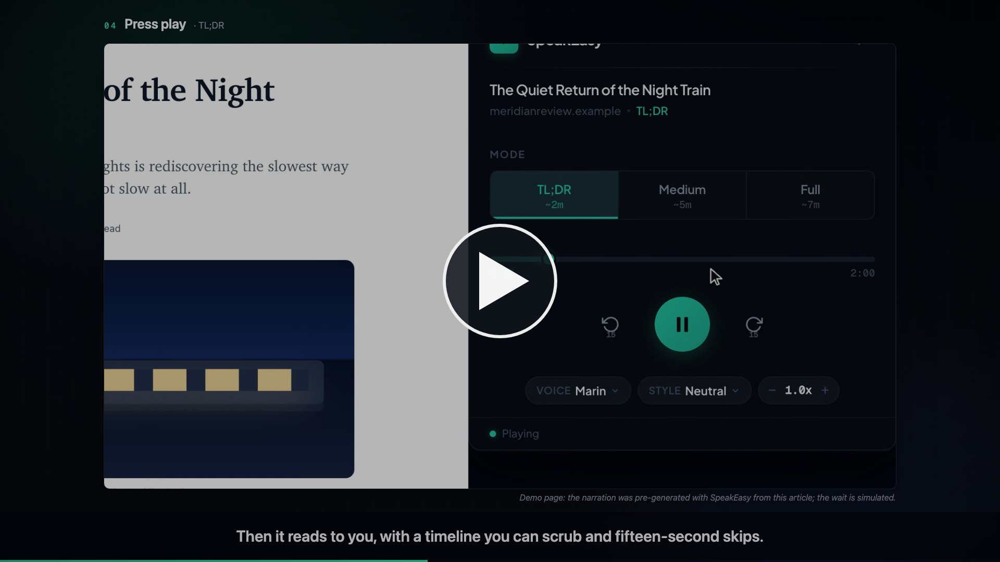

# SpeakEasy

[](https://ericediger.github.io/SPEAKEASY/media/speakeasy-explainer.mp4)

**[▶ Watch the 2-minute explainer](https://ericediger.github.io/SPEAKEASY/media/speakeasy-explainer.mp4)** · **[Try the live demo](https://ericediger.github.io/SPEAKEASY/demo/)**

The demo is the real side panel on a fictional article, with narration pre-generated by SpeakEasy. Nothing is saved, nothing is sent, and no API key is needed.

AI-powered Chrome extension that summarizes web articles and reads them aloud using OpenAI. Free to use with your own OpenAI API key.

## Features

- **Article Extraction** - Automatically extracts article content from any webpage
- **Three Listening Modes** - TL;DR (~2 min), Medium (~5 min), or the Full article
- **10 Voices** - Marin and Cedar (recommended), plus Alloy, Ash, Ballad, Coral, Echo, Sage, Shimmer, Verse
- **6 Speaking Styles** - Neutral, Energetic, Calm, Professional, Conversational, Storytelling
- **Real-time Controls** - Change voice or style mid-playback, audio regenerates automatically
- **Speed Control** - Adjustable from 0.5x to 2.0x in 0.1 increments
- **Accuracy Check** - Each narrated segment is compared with its text and re-narrated if it drifts
- **Smart Caching** - Summaries and audio cached locally for 7 days to avoid redundant API calls

## How it works

| Step | Model | Notes |
|------|-------|-------|
| Summarize (TL;DR, Medium) | `gpt-6-luna` | ~300 words for TL;DR, ~750 for Medium. Articles already that short are read in full. |
| Read aloud (all modes) | `gpt-realtime-2.1-mini` | Text is narrated in ~1 minute segments, several at a time, then joined into one audio file. |

Everything runs in the extension with the user's own key; there is no SpeakEasy server.

### Approximate cost per listen (paid by the user's OpenAI account)

| Mode | Cost |
|------|------|
| TL;DR | ~5¢ |
| Medium | ~12¢ |
| Full (1,500-word article) | ~22¢ |

Summaries add less than 0.1¢. Narration is about 2.4¢ per minute of audio; re-narrated segments cost extra.

## Installation

### Prerequisites
- Node.js 18+ (to build)
- OpenAI API key ([get one here](https://platform.openai.com/api-keys)) on an account with prepaid credit (at least $5)

### Setup

```bash
# Clone the repository
git clone https://github.com/ericediger/SPEAKEASY.git
cd SPEAKEASY

# Install dependencies
npm install

# Build the extension
npm run build
```

### Load in Chrome

1. Open `chrome://extensions/`
2. Enable **Developer mode** (toggle in top right)
3. Click **Load unpacked**
4. Select the `dist` folder

### Configure

1. Click the SpeakEasy extension icon
2. Click the settings icon (top right)
3. Enter your OpenAI API key
4. Click **Validate** then **Save Settings**

## Usage

1. Navigate to any article or blog post
2. Click the SpeakEasy extension icon
3. Select a mode (TL;DR, Medium, Full)
4. Click the play button to generate and play audio
5. Adjust voice, style, or speed as needed

## Development

```bash
# Start dev server with hot reload
npm run dev

# Build for production
npm run build

# Build and copy the extension to ~/Desktop/SPEAKEASY for loading in Chrome
npm run deploy

# Narrate three Wikipedia articles and report accuracy, timing, and cost (~$1 of credit).
# Reads OPENAI_API_KEY from the environment or a .env file; audio is saved to test-output/
npm run test:reading

# Rebuild demo/app (the copy of the side panel and settings page the demo page runs) after changing the extension
npm run demo

# Re-generate the demo page's narration clips with SpeakEasy's own code (~25¢ of credit)
npm run demo:audio
```

### Demo page

`demo/index.html` is the [live demo](https://ericediger.github.io/SPEAKEASY/demo/): a Chrome-style window with two fictional articles and the extension's real side panel and settings page, built from `src/` into `demo/app/`. `demo/mocks.js` stands in for `chrome.*` and the service worker; the narration it plays was generated by SpeakEasy from the demo articles (`demo/audio/`), so nothing on the page calls OpenAI. The explainer video is recorded from the same page.

## Tech Stack

- **Frontend**: React 18, TypeScript
- **Build**: Vite + CRXJS
- **Storage**: Chrome Storage API (settings), IndexedDB (cache)
- **APIs**: OpenAI Chat Completions (`gpt-6-luna` summaries), OpenAI Realtime API over WebSocket (`gpt-realtime-2.1-mini` narration)

## Project Structure

```
src/
├── background/
│   └── service-worker.ts    # API orchestration, message handling
├── content/
│   └── extractor.ts         # Article content extraction
├── lib/
│   ├── cache.ts             # IndexedDB caching layer
│   ├── narration.ts         # Realtime narration, accuracy check, WAV assembly
│   ├── openai.ts            # Summaries and API key validation
│   ├── storage.ts           # Chrome storage utilities
│   └── types.ts             # Types, modes, voices, styles
├── popup/
│   └── Popup.tsx            # Main popup UI
├── options/
│   └── Options.tsx          # Settings page
└── styles/
    └── popup.css            # Styling
scripts/
├── reading-test.ts          # Narration accuracy test against real articles
├── build-demo.mjs           # Copies the built panel and settings page into demo/app/
└── demo-audio.ts            # Pre-generates the demo page's narration with SpeakEasy's own code
demo/                        # Live demo page (GitHub Pages) and the explainer's recording stage
media/                       # Explainer video and poster
```

## License

MIT
